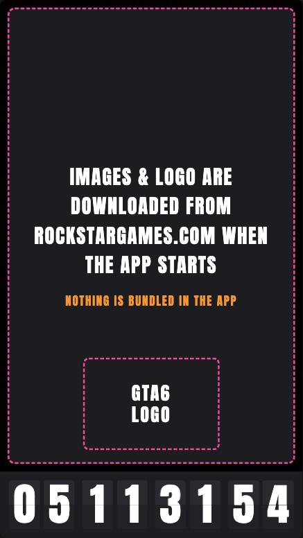

# GTA6 COUNTDOWN

*[English version](README.md)*

Ein kleines Hochkant-Widget (9:16, Postkartengröße) für macOS: eine **Flughafen-Klapptafel**, die bis zum Erscheinen von Grand Theft Auto VI herunterzählt, dahinter eine Diashow mit offiziellen Bildern.

<p align="center"></p>

- Klapptafel-Countdown (Tage / Stunden / Minuten / Sekunden) mit der typischen Klapp-Animation
- Rund 200 offizielle Screenshots, zufällig gemischt, alle 5 Sekunden ein neues, jeweils so in 9:16 gesetzt, dass Gesichter im Bild bleiben
- Bildkategorien wählbar, Countdown-Ziel frei einstellbar
- Winzig: die App ist etwa 1 MB groß, **es sind keine Bilder und kein Logo eingebaut**

## Download und Installation

1. `GTA6-COUNTDOWN.dmg` vom [neuesten Release](../../releases/latest) laden.
2. DMG öffnen und **GTA6 COUNTDOWN** in den Ordner **Programme** ziehen.
3. Erster Start: Die App ist **nicht notarisiert** (dafür braucht es einen kostenpflichtigen Apple-Entwickler-Account), macOS zeigt deshalb eine Warnung. **Rechtsklick auf die App → Öffnen → Öffnen.** Das ist nur einmal nötig.

   Verweigert macOS trotzdem, einmal im Terminal:
   ```bash
   xattr -dr com.apple.quarantine "/Applications/GTA6 COUNTDOWN.app"
   ```

Voraussetzung: macOS 11 oder neuer auf einem Mac mit Apple-Silicon-Chip und Internet für die Bilder (der Countdown läuft auch ohne).

## Bedienung

| Was | Wie |
| --- | --- |
| Einstellungen öffnen | **Lang drücken** (ca. 0,7 s) irgendwo im Fenster, oder in der Menüleiste **GTA6 COUNTDOWN → Settings…** (⌘,) |
| Bilder wählen | Kategorien anhaken oder **All** |
| Countdown ändern | Unter **Countdown to** Datum und Uhrzeit setzen (Ortszeit deines Macs). **Reset** stellt 19.11.2026, 0:00 Uhr wieder her |
| Übernehmen | **Done** (die Auswahl wird gemerkt) |
| Beenden | ⌘Q oder roter Fensterknopf |


Bei null pulsieren die Ziffern den ganzen Tag lang, danach verschwindet die Anzeige.

## Woher die Bilder kommen

Alle Bilder und das GTA-VI-Logo gehören **Rockstar Games / Take-Two Interactive**. Dieses Projekt enthält, kopiert oder hostet **nichts davon**.

1. Beim Start liest die App Rockstars offizielle Download-Seiten (`rockstargames.com/VI/downloads` und `/screenshots`), die zum Herunterladen und Teilen gedacht sind.
2. Sie sucht die aktuellen Bildadressen heraus (die Dateinamen enthalten einen Hash, der sich bei Updates der Seite ändert, deshalb schaut die App jedes Mal nach).
3. Bilder und Logo werden dann **direkt von rockstargames.com** ins Fenster geladen. Gespeichert wird nichts außer dem normalen Web-Cache.
4. Kein Internet oder Rockstar nicht erreichbar? Dann bleibt das Bildfeld schwarz, der Countdown läuft weiter.

### Kategorien

| Kategorie | Inhalt | Bilder |
| --- | --- | --- |
| Places | Vice City, Leonida Keys, Ambrosia, Grassrivers, Mount Kalaga National Park, Port Gellhorn | 55 |
| People | Jason Duval, Lucia Caminos, Jason and Lucia, Boobie Ike, Brian Heder, Cal Hampton, DreQuan Priest, Raul Bautista, Real Dimez | 77 |
| Ultimate Edition | Fahrzeuge, Waffen, Outfits der Ultimate Edition | 51 |
| Vintage Vice City | Das Vintage Vice City Pack | 12 |
| Artworks | Hochformat-Artworks (nur 4 gibt es als Einzeldatei) | 4 |

### So funktioniert der 9:16-Ausschnitt

Die Originale sind 16:9, das Fenster ist 9:16, es passt also nur etwa ein Drittel der Breite hinein. In `images.json` steht für jedes Bild **Name, Kategorie und waagerechte Ausschnitt-Position** (z. B. „29 % von links“). Die Positionen wurden einmal mit der macOS-Bilderkennung (Vision: Gesichter und Personen) berechnet, damit keine Köpfe abgeschnitten werden und Gruppen mittig sitzen; Bilder ohne Personen werden aufs Hauptmotiv zentriert. Die App setzt den Ausschnitt nur auf dem Bildschirm, die Bilddateien werden nie verändert.

Fügt Rockstar später neue Bilder hinzu, erscheinen sie erst, wenn `images.json` erweitert wird. Benennt Rockstar ein Bild um, fällt nur dieses eine raus.

## Datenschutz

- Die App spricht nur mit `rockstargames.com` (Seite, Bilder, Logo).
- Kein Tracking, keine Konten, keine Statistik, keine Werbung.
- Deine Einstellungen (Kategorien, Countdown-Datum) liegen lokal auf deinem Mac.

## Selbst bauen

Du brauchst [Rust](https://rustup.rs).

```bash
cd gta6-widget
cargo build --release
./target/release/gta6-countdown-widget
```

Die Webseite (`index.html`) läuft auch im Browser: `python3 -m http.server 8666` im Projektordner, dann `http://localhost:8666/` öffnen. Im Browser gilt die Bildliste aus `images.json` unverändert.

### Aufbau

```
index.html            das ganze Widget (HTML, CSS, JavaScript)
images.json           Bildnamen, Kategorien, Ausschnitte (keine Bilder)
logo.url              Adresse des Logos auf rockstargames.com
gta6-widget/          die Rust-App (wry + tao + muda), bettet die Dateien oben ein
docs/                 Screenshots für diese Seite
```

## Hinweis

Inoffizielles Fan-Projekt, nicht kommerziell, nicht mit Rockstar Games oder Take-Two Interactive verbunden oder von ihnen unterstützt. „Grand Theft Auto“, „GTA VI“, das Logo und alle Bilder gehören ihren Eigentümern. Es gilt Rockstars [Richtlinie zur Fan-Nutzung](https://support.rockstargames.com/articles/7bNaeoMFTV0iUDGhStTXvz/policy-on-posting-copyrighted-rockstar-games-material). Wenn du Rockstar oder Take-Two vertrittst und etwas geändert oder entfernt haben möchtest, eröffne bitte ein Issue, es wird umgesetzt.

Der Quellcode steht unter der MIT-Lizenz (siehe `LICENSE`). Sie gilt nicht für Rockstars Marken und Bilder.
