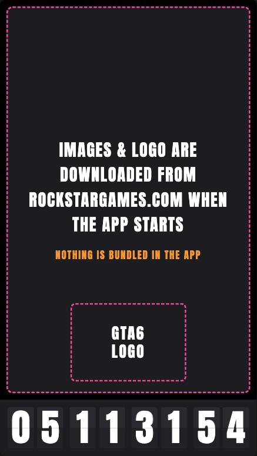
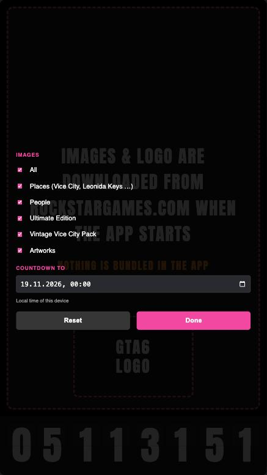

# GTA6 COUNTDOWN

*[Deutsche Version](README.de.md)*

A small portrait widget (9:16, postcard size) for macOS: a **split-flap airport display** counting down to the release of Grand Theft Auto VI, with a slideshow of official artwork behind it.

<p align="center"></p>

- Split-flap countdown (days / hours / minutes / seconds) with the classic flip animation
- ~200 official screenshots, shuffled, one every 5 seconds, each framed for 9:16 so faces stay in the picture
- Pick which image categories you want and set your own countdown target
- Tiny: the app is about 1 MB, **no images or logos are bundled**

## Download and install

1. Download `GTA6-COUNTDOWN.dmg` from the [latest release](../../releases/latest).
2. Open the DMG and drag **GTA6 COUNTDOWN** into **Applications**.
3. First launch: the app is **not notarized** (that needs a paid Apple developer account), so macOS will warn you. **Right-click the app → Open → Open.** You only need to do this once.

   If macOS still refuses, run this once in Terminal:
   ```bash
   xattr -dr com.apple.quarantine "/Applications/GTA6 COUNTDOWN.app"
   ```

Requirements: macOS 11 or later on an Apple Silicon Mac, and an internet connection for the pictures (the countdown works without).

## Using the widget

| What | How |
| --- | --- |
| Open settings | **Long-press** (about 0.7 s) anywhere on the window, or **GTA6 COUNTDOWN → Settings…** in the menu bar (⌘,) |
| Choose images | Tick the categories you want, or **All** |
| Change the countdown | Set date and time under **Countdown to** (local time of your Mac). **Reset** goes back to 19 Nov 2026, 00:00 |
| Apply | **Done** (your choice is remembered) |
| Quit | ⌘Q or the red window button |

<p align="center"></p>

When the countdown reaches zero the digits pulse for the whole day, then the display disappears.

## Where the pictures come from

All pictures and the GTA VI logo belong to **Rockstar Games / Take-Two Interactive**. This project does **not** contain, copy or re-host any of them.

1. At launch the app reads Rockstar's official download pages (`rockstargames.com/VI/downloads` and `/screenshots`), which are published for fans to download and share.
2. It picks out the current picture addresses (the file names contain a hash that changes when Rockstar updates the site, so the app looks them up each time).
3. The pictures and the logo are then loaded **straight from rockstargames.com** into the window. Nothing is saved by the app besides normal web caching.
4. No internet, or Rockstar unreachable? The picture area stays black, the countdown keeps running.

### Categories

| Category | What's in it | Pictures |
| --- | --- | --- |
| Places | Vice City, Leonida Keys, Ambrosia, Grassrivers, Mount Kalaga National Park, Port Gellhorn | 55 |
| People | Jason Duval, Lucia Caminos, Jason and Lucia, Boobie Ike, Brian Heder, Cal Hampton, DreQuan Priest, Raul Bautista, Real Dimez | 77 |
| Ultimate Edition | Vehicles, weapons, outfits from the Ultimate Edition | 51 |
| Vintage Vice City | The Vintage Vice City Pack | 12 |
| Artworks | Portrait artworks (only 4 are published as single files) | 4 |

### How the 9:16 framing works

The originals are 16:9, the window is 9:16, so only about a third of the width fits. The file `images.json` stores, for every picture, its **name, category and horizontal crop position** (e.g. "29 % from the left"). The crop positions were computed once with macOS' Vision framework (face and person detection) so that heads are not cut off and groups are centered; pictures without people are centered on the main subject. The app applies the crop on screen, the picture files are never modified.

If Rockstar adds new pictures later, they will not show up until `images.json` is extended. If Rockstar renames a picture, only that one drops out.

## Privacy

- The app only talks to `rockstargames.com`, to fetch the page, the pictures and the logo.
- No tracking, no accounts, no analytics, no ads.
- Your settings (categories, countdown date) are stored locally on your Mac.

## Build from source

You need [Rust](https://rustup.rs).

```bash
cd gta6-widget
cargo build --release
./target/release/gta6-countdown-widget
```

The web page itself (`index.html`) also runs in any browser: `python3 -m http.server 8666` in the project folder, then open `http://localhost:8666/`. In a browser the picture list in `images.json` is used as it is.

### Project layout

```
index.html            the whole widget (HTML, CSS, JavaScript)
images.json           picture names, categories, crop positions (no pictures)
logo.url              address of the logo on rockstargames.com
gta6-widget/          the Rust app (wry + tao + muda), embeds the files above
docs/                 screenshots for this page
```

## Disclaimer

Unofficial fan project, non-commercial, not affiliated with or endorsed by Rockstar Games or Take-Two Interactive. "Grand Theft Auto", "GTA VI", the logo and all pictures are the property of their owners. Rockstar's [policy on fan use](https://support.rockstargames.com/articles/7bNaeoMFTV0iUDGhStTXvz/policy-on-posting-copyrighted-rockstar-games-material) applies. If you represent Rockstar/Take-Two and want something changed or removed, please open an issue and it will be done.

The source code is released under the MIT License (see `LICENSE`). That license does not cover Rockstar's marks or images.
